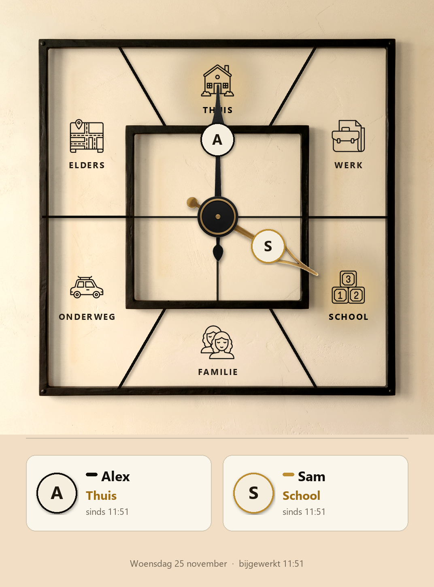

# Modern Square Family Clock for Home Assistant & Kobo e-Readers

Een moderne, architectonische **Weasley-style familieklok** voor Home Assistant — geïnspireerd op een vierkante zwart smeedijzeren wandklok op warm kalkstuc.

Deze repository bevat:
1. **Home Assistant App (Add-on) `Kobo Familieklok`** — rendert server-side een haarscherpe `1072×1448` kleuren-PNG + ultralichte webpagina voor **Kobo Clara Colour** (via NickelMenu) of andere e-ink schermen (zoals ESP32/ESPHome of TRMNL).
2. **Custom Lovelace Card (`lovelace/modern-family-clock-card.js`)** — dezelfde klok live & geanimeerd op je Home Assistant dashboard.
3. **Alle losse hoge-resolutie PNG-assets** (`kobo_klok/assets/`): kalkstuc achtergrond, transparant smeedijzeren frame met schaduwen, smeedijzeren & geborsteld messing wijzers, middenstuk en locatie-iconen.

<p align="center">
  
</p>

## Kenmerken
- **3-laags opbouw:** warme kalkstuc wand → wiskundig exacte vakgrenzen → transparant smeedijzeren vierkant frame mét schaduwen eroverheen.
- **Profielfoto's op de wijzers:** ronde medaillons halverwege elke wijzer die automatisch rechtop blijven staan en licht uitwaaieren als gezinsleden op dezelfde locatie zijn.
- **E-ink geoptimaliseerd:** geen zware browser op de server nodig (rendert via Python + Pillow in < 0,2 sec), subtiele Kaleido 3 kleur-boost en automatische refresh.
- **Kobo blijft 100% normale e-reader:** via NickelMenu open je de klok met één tik fullscreen en sluit je hem weer om verder te lezen.

---

## Installeren als Home Assistant App (Add-on)

[](https://my.home-assistant.io/redirect/supervisor_add_addon_repository/?repository_url=https%3A%2F%2Fgithub.com%2FDeRoelO%2FHA_kobo_weasly_clock)

1. Klik op de knop hierboven — of ga in Home Assistant naar **Instellingen → Apps → App-winkel → `⋮` → Opslagplaatsen** en voeg toe:
   ```text
   https://github.com/DeRoelO/HA_kobo_weasly_clock
   ```
2. Installeer **Kobo Familieklok**, vul onder **Configuratie** jouw personen (`persons`) en locaties (`sections`) in en start de app.
3. De klok draait direct op `http://<homeassistant-ip>:8099/` (en als losse PNG op `/klok.png`).

---

## Kobo Clara Colour instellen met NickelMenu

1. Download de nieuwste `KoboRoot.tgz` van [pgaskin/NickelMenu](https://github.com/pgaskin/NickelMenu/releases), kopieer die naar `.kobo/` op je Kobo en werp veilig uit.
2. Kopieer [`kobo_klok/nickelmenu/familieklok`](kobo_klok/nickelmenu/familieklok) naar `.adds/nm/familieklok` op je Kobo en pas eventueel het IP-adres aan:
   ```text
   menu_item :main :Familieklok :nickel_browser :modal:http://homeassistant.local:8099/
   menu_item :main :WiFi aan (klok) :nickel_setting :toggle :force_wifi
     chain_success :nickel_wifi :autoconnect
   ```
3. Tik op je Kobo rechtsonder op **NickelMenu → Familieklok**.

---

## Losse Docker-installatie (optioneel)

```bash
cp .env.example .env
# Vul HA_URL en HA_TOKEN in .env in
docker compose up -d --build
```

## Lovelace Dashboard Card (optioneel)

Kopieer `lovelace/modern-family-clock-card.js` naar `/config/www/` en registreer `/local/modern-family-clock-card.js` als Lovelace JavaScript-module.

```yaml
type: custom:modern-family-clock-card
persons:
  - entity: person.alex
    person_entity: person.alex
    name: Alex
    hand: iron
    color: "#1c1c1c"
  - entity: person.sam
    person_entity: person.sam
    name: Sam
    hand: brass
    color: "#b8924a"
```

---

## Credits
- Locatie-iconen (Detailed Outline) door [Aranagraphics](https://www.flaticon.com/authors/aranagraphics) via Flaticon.
- Geïnspireerd op de [La Maison Chic 120cm Square Wall Clock](https://www.la-maison-chic.co.uk/item/extra-large-120cm-black-finish-square-wall-clock/).
